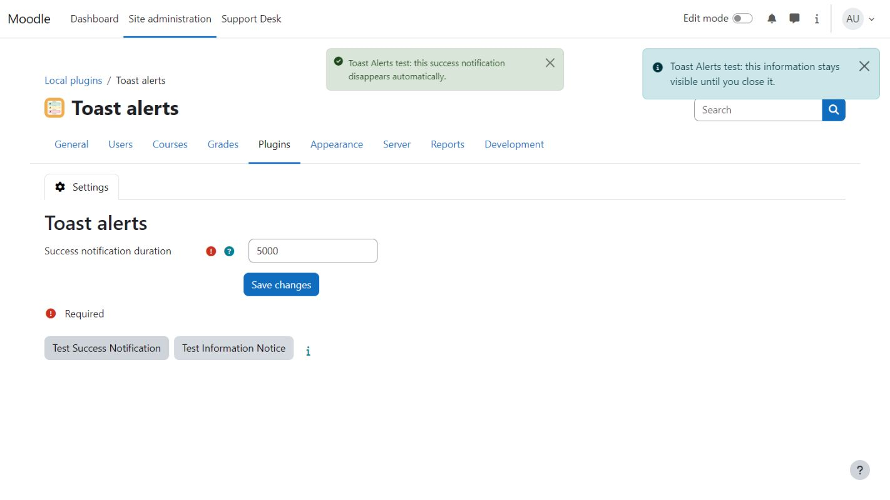
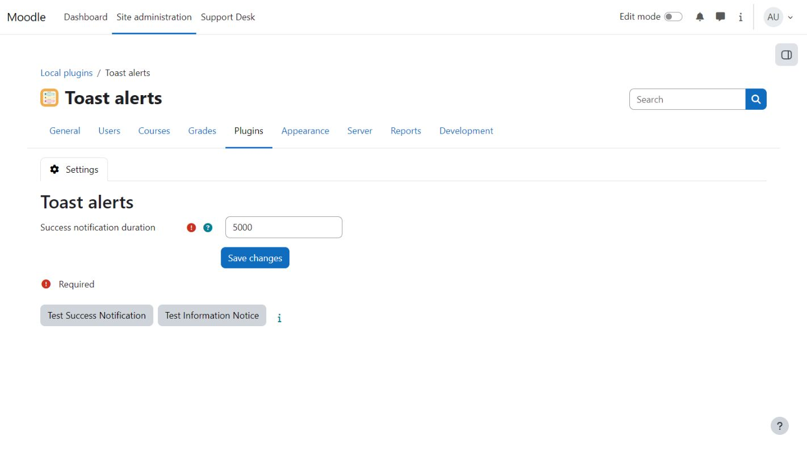

<p align="center">
  
</p>

# Toast Alerts

Toast Alerts unifies the different notification styles used by older Moodle versions and plugins,
using Moodle 5.3 as its visual reference. It gives global notifications and Core toasts consistent
placement, timing and dismiss controls across Moodle 4.5 to 5.3. Deliberate inline alerts in page
content remain in place unless their producer explicitly opts in.

## Installation and settings

Install as `local/toastalerts` and complete Moodle's normal upgrade step. Open
**Site administration > Plugins > Local plugins > Toast alerts** to set the success
notification duration. This distribution needs no license activation or 108design account.

Save the duration, then use **Test Success Notification** or **Test Information Notice**
to preview each type in your current browser. The examples do not notify other users.

## Behaviour

- Success notifications and notices marked `local-toastalerts-autohide` appear in a fixed top-centre lane and
  auto-dismiss after the configured delay (default: 5000 ms).
- Persistent info, warning and error notifications appear in a fixed top-right stack.
- Only notifications explicitly marked `local-toastalerts-inline` remain in Moodle's normal page notification region.
- Native `core/toast` output from all body-level Core wrappers shares the top-centre lane. Persistent and danger Core
  toasts are converted to the persistent right-hand lane.
- Every global notification receives a dismiss button and the familiar Moodle Core severity icon.
- Hover and keyboard focus pause a running auto-dismiss timer.
- Both floating lanes follow the visible fixed top navigation. The persistent lane stays anchored to the right
  viewport edge even when a Moodle drawer opens or closes.

Notification producers may add `local-toastalerts-persistent` to keep a success message visible,
`local-toastalerts-autohide` to auto-dismiss another non-error severity, or `local-toastalerts-inline` when contextual
placement is essential. Errors always remain persistent, but can be kept inline explicitly.

An alert rendered outside `#user-notifications` can opt into the same policy with `local-toastalerts-adopt`. Optional
`data-local-toastalerts-type`, `data-local-toastalerts-mode` and `data-local-toastalerts-delay` attributes select its
severity, lane and transient duration. The actual element is moved, so existing actions such as Undo keep working.

## JavaScript API

Plugins can import `local_toastalerts/manager` and describe the notification's meaning instead of selecting a
Moodle output channel:

```javascript
import {success, notice, warning, error} from 'local_toastalerts/manager';

success('Saved');
notice('A persistent informational message');
warning('A persistent warning');
error('A persistent error');
error('A contextual form error', {mode: 'inline'});
```

The generic `add(message, options)` export accepts `type` (`success`, `info`, `warning`, `error`) and an optional
`mode` (`transient`, `persistent`, `inline`). Errors cannot be transient; their default is persistent.

## Compatibility

Toast Alerts is compatible with Moodle 4.5, 5.0, 5.1, 5.2 and 5.3. Moodle 5.3 is the reference
for its notification presentation on older versions. Managed alerts do not call Bootstrap's Alert API.
Native Core toasts continue to use Moodle's own `core/toast` implementation, avoiding direct coupling
to a Bootstrap version.

## Screenshots





## Support

Report reproducible problems in the [issue tracker](https://github.com/108design/moodle-local_toastalerts-marketplace/issues).
Include your Moodle and PHP versions, the active theme, and the steps needed to reproduce the problem.
Remove personal data and sign-in links from reports.

## License

This is a 108design source-available commercial software license, not an open-source license. See [LICENSE.md](LICENSE.md) for the full terms.
